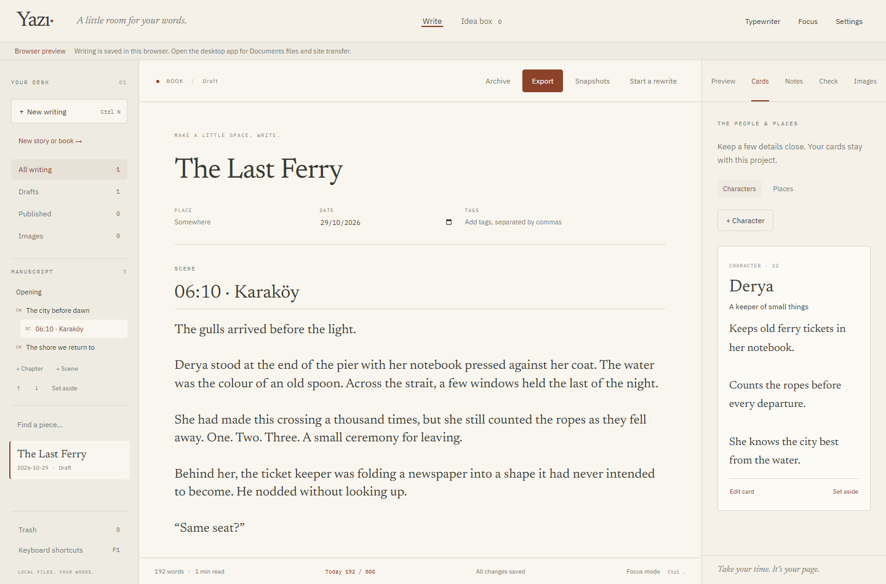

# Yazı

A quiet Windows desktop app for writing. English interface, any writing language. Local Markdown and JSON, no account or cloud sync.

Warm paper, Newsreader, IBM Plex, a little rust. A writing desk, an idea board, and a place for images.

## Development

Requires Node.js 22.17+, Rust stable (MSVC), Microsoft C++ Build Tools with the Windows SDK, and WebView2. Install the prerequisites described in the [Tauri Windows guide](https://v2.tauri.app/start/prerequisites/#windows).

To inspect the interface without installing Rust, double-click **`preview.cmd`** from Windows Explorer. It installs the JavaScript packages in this project, checks the frontend build, and opens the browser when the development server is ready. Leave its console window open while using the preview. It needs a network-enabled normal Windows session for the initial package installation; the agent's restricted shell cannot do that download. This launcher is prepared but has not been run end to end here.

`node scripts/doctor.mjs` checks the browser prerequisites; `npm.cmd run doctor` also checks Rust and the Windows C++ tools. These checks do not install software or change settings. `run.cmd` and `build.cmd` display missing prerequisites rather than closing on an unexplained error.

```powershell
npm.cmd install
npm.cmd run desktop
```

For an isolated browser preview:

```powershell
npm.cmd run dev
```

The preview uses browser storage, clearly labelled in the interface. It cannot write to Documents or publish. Desktop data is not read or changed by the browser preview. Keep browser test images under 3 MB; desktop supports originals up to 100 MB.

```powershell
npm.cmd test
npm.cmd run build
npm.cmd run test:ui
cargo test --manifest-path src-tauri/Cargo.toml
npm.cmd run package
```

The NSIS installer is written to `src-tauri/target/release/bundle/nsis/`. Its shortcut configuration uses Tauri's Windows installer defaults. Installer size and shortcut behavior still need verification on a built installer.

## Your writing

The desktop app resolves your actual Windows Documents folder (including redirected folders) and stores:

```text
Documents/Yazi/
  settings.json
  projects/<id>/project.json
  projects/<id>/draft.md
  ideas/<id>.json
  images/<id>/image.json
  images/<id>/original.<extension>
  _trash/<entry>/entry.json
  _trash/<entry>/content
```

Records have a `schemaVersion`. Project IDs are stable; changing the title or site address does not move the local draft. `draft.md` contains ordinary Markdown. Local images use ``; these references become site paths only during transfer. Writing metadata lives in `project.json`, without duplicating the body there.

Autosave serializes writes, drains edits made while saving, flushes before switching drafts and closing the desktop window, and checks the revision against disk before replacing content. The independently tested draft session blocks switching away from unsaved text after an error. Each project uses `.recovery.json` to finish an interrupted two-file save, and `.last-save.json` keeps the most recent full transaction. If recovery would replace different on-disk text, that version is first kept under the project's `.recovered/` folder. These are recovery records, not version history. A disk conflict keeps unsaved text in the editor and displays an error. Copy that text before reloading. A second desktop instance focuses the first one.

Archive and removal move records into `_trash`, with Restore in the UI. There is no permanent-delete action. Images referenced by writing cannot be moved to trash through the UI. Failed image imports remain under `.staging` and do not interrupt the library.

## Send to site

Set the local `modernist-portfolio` folder in Settings. Sending requires Node.js 22 and the site's installed dependencies. The app does not bundle Node or sharp, keeping the writing app small; the editor itself works without them.

1. Finish the title, date, text, address, excerpt and standfirst.
2. Choose **Send to site**, then **Check repository**.
3. Review the exact files and `post/<slug>` branch. Confirm with **Create local commit**.

The bridge requires a clean working tree, an unused branch and an unused post address. It checks the content-check command and image destinations before changing the branch, and repeats the repository checks after image preparation. Windows-reserved file names are rejected. The desktop command also checks that the on-disk draft revision matches the text reviewed in the editor. It writes Keystatic-compatible essay frontmatter and only the referenced images. It imports `scripts/lib/exif.mjs` directly from the site repository, without maintaining a second EXIF policy. Original images remain untouched; site JPEGs are oriented and resized to at most 2560 px with the site's camera-field allowlist, ICC profile preservation and post-processing privacy verification.

The bridge executes the site's `check:content` Node command directly, with the same arguments as `npm run check:content` and no shell interpolation. It checks that the package script still matches before proceeding. It commits only the listed files. Commit hooks are disabled for this content-only operation so a hook cannot stage or change unrelated files. Nothing is pushed.

After a successful commit the linked idea becomes Published. The site remains on the new local branch for review. If checking fails, files remain on that branch, no commit is made, and the idea stays a draft. Review or resolve that branch in Git before retrying. A draft already sent cannot be sent again in this first version; revisions to an existing site post are a later workflow.

## Keyboard

| Action | Shortcut |
|---|---|
| New writing | Ctrl+N |
| New story or book | Ctrl+Shift+N |
| Add chapter / scene | Ctrl+Alt+1 / Ctrl+Alt+2 |
| Character/place cards | Ctrl+Alt+K |
| Project notebook | Ctrl+Alt+N |
| Snapshots | Ctrl+Alt+V |
| Export story/book | Ctrl+Shift+E |
| Save now | Ctrl+S |
| Idea capture | Ctrl+Shift+I |
| Send to site | Ctrl+Shift+Enter |
| Focus mode | Ctrl+. |
| Settings | Ctrl+, |
| Help | F1 |
| Leave focus / close dialog | Esc |

All controls are reachable with Tab / Shift+Tab. Markdown undo/redo uses Ctrl+Z / Ctrl+Shift+Z. Native spellcheck is enabled; dedicated English/Turkish style suggestions are not implemented yet. Playwright browser tests cover persistence, idea-to-draft, archive/restore, focus/theme and preview sanitization; the complete browser suite passed using the installed Chrome during phase 2.

## Stories and books

Choose **New story or book** in the library. Blog posts keep their existing single-text/site workflow. Stories can use one text, scenes, or both. Books have an Opening and chapters with scenes. Every section has its own text and editor undo history.

- **Outline:** add chapters/scenes, rename the selected section above its text, drag to reorder or move a scene to another chapter. Up/down buttons provide keyboard-accessible ordering. **Set aside** preserves a section and its descendants; Restore brings them back.
- **Cards:** character/place cards with age, aliases, impressions and details. Set-aside cards remain recoverable within the project.
- **Notes:** research notes, a timeline with free-form event times, daily word goals and a local writing log. The log counts increases/decreases in manuscript word count; metadata and snapshot restoration do not earn writing credit. No AI or cloud service is involved.
- **Typewriter:** keeps the current line near the middle of the writing pane. Toggle with the toolbar or Ctrl+Alt+T. It works with Focus mode.
- **Start a rewrite:** keeps a snapshot of the selected chapter/scene (or the whole manuscript when Opening/Single text is selected) before returning to the editor. **Snapshots** compares a kept version with current text side by side. Restoring first preserves the current version as another snapshot. Kept versions cannot be edited or deleted through the app.
- **Export:** copies the whole manuscript in reading order; cards, notes and set-aside writing are excluded. Markdown can be downloaded without extra tools. Installed Pandoc enables DOCX/EPUB and normalized Markdown; PDF additionally needs Typst, XeLaTeX, LuaLaTeX, Tectonic or WeasyPrint on PATH. Typst requires Pandoc 3+. Each export uses a new filename and never overwrites an earlier copy.

In the desktop app, scene/chapter text lives in `projects/<id>/sections/<section-id>.md`. Cards and notes have their own JSON files. Snapshots keep immutable JSON plus readable Markdown under `snapshots/`. Set-aside parts move to `_trash/project-<id>/sections`, `cards`, or `notes`, and are restored from their project UI. Whole-project Trash still works as before. Desktop exports go to `Documents/Yazi/exports/`.

The development browser preview provides the same export dialog through a loopback-only local bridge, returning a browser download. It uses only that isolated preview's project data and images. The static production website build is not a browser-hosted app: use the desktop shell or the development preview for the local export bridge.



[Snapshot comparison](docs/screenshots/phase2-snapshots.png) · [Typewriter](docs/screenshots/phase2-typewriter.png) · [Export](docs/screenshots/phase2-export.png) · [Compact layout](docs/screenshots/phase2-compact.png) · [Exported sample Markdown](docs/examples/the-last-ferry.md)

## Status

Phase 1 and phase 2 source are implemented. The production frontend build, 27 Node tests and 13 browser tests pass. The screenshots and sample Markdown above come from actual browser-preview interactions in an isolated test profile.

Rust/MSVC and Pandoc/PDF engines are not installed in the agent environment. Native storage tests and Windows packaging remain unexecuted. Real DOCX/EPUB/PDF rendering remains unverified; process-contract tests are explicitly distinguished from rendering tests. The browser preview's real Markdown download works. See [verification](docs/verification.md). Phase 2's acceptance milestone still requires Emir to finish a story and export a PDF with the actual tools.

The main `.git` directory is read-only in this session. Separate commits for each feature are preserved in the copied local repository `.tools/phase2-history`, with a portable `.tools/yazi-phase2.bundle`. No commits were written into the protected main `.git`, and nothing was pushed. See [portable history](docs/phase2-history.md).

MIT. Font packages include their own open font licenses.
