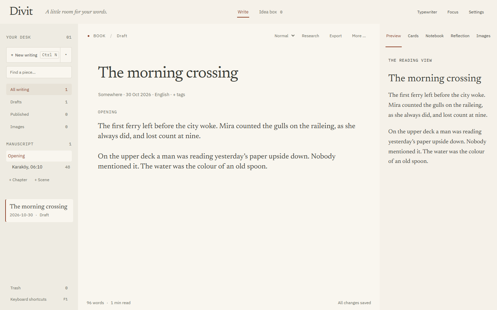
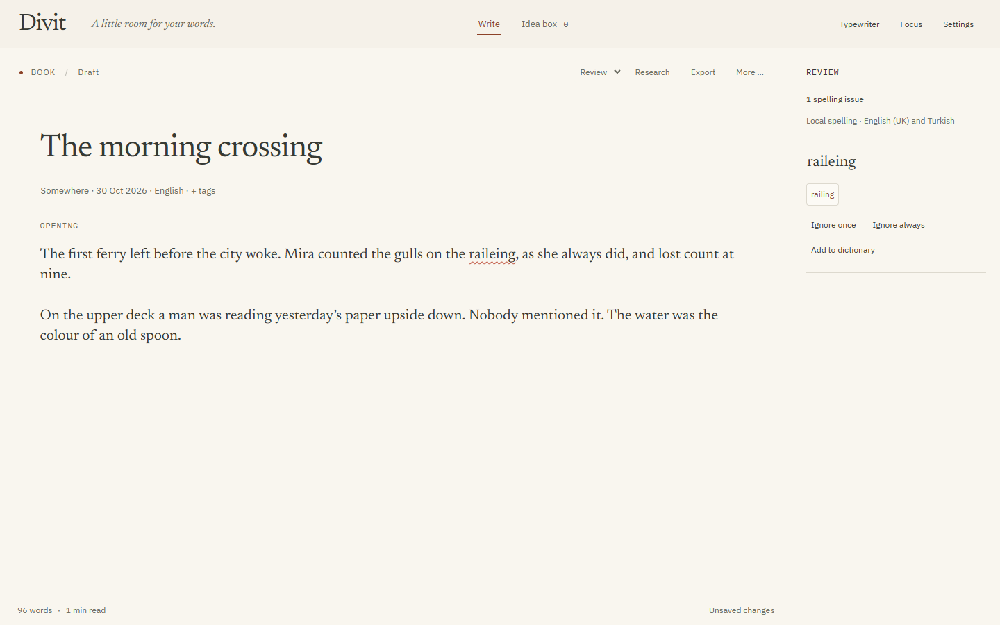
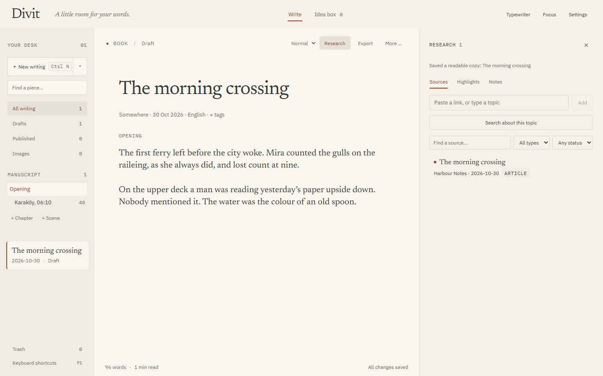
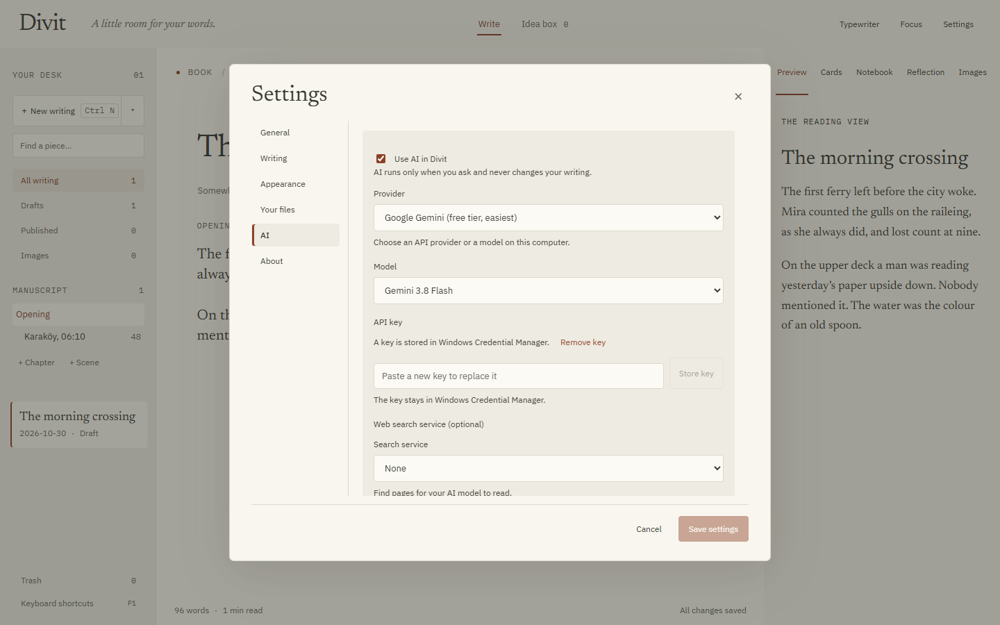

<p align="center"></p>

# Divit

A quiet Windows app for writing blog posts, stories and books. Your writing stays on your computer as plain Markdown files. Research and AI are there when you ask for them and silent when you don't. The interface is in English or Turkish, and you can write in any language.



> **Beta.** This is 0.1.0-beta.2. Keep a backup of anything important and [tell us what breaks](https://github.com/illfollowthesun/Divit/issues/new/choose).

## Download

Get the installer from the [latest release](https://github.com/illfollowthesun/Divit/releases/latest):

- **Divit_0.1.0-beta.2_x64-setup.exe** is the usual choice. It installs for your Windows user only and needs no administrator rights.
- **Divit_0.1.0-beta.2_x64_en-US.msi** is for managed or company PCs.

The installer is **not code-signed** yet, so Windows SmartScreen may warn about an unknown publisher. Choose **More info → Run anyway** if you downloaded it from the release page above. Divit then checks GitHub for updates when it starts and asks before installing one. Updates are signed, and Divit refuses any that are not.

Divit runs on Windows 10 and 11 and uses Microsoft Edge WebView2, which Windows already includes.

## First steps

1. **Start writing.** Press **Ctrl N** for a blog post, or **Ctrl Shift N** for a story or a book.
2. **Bring in what you have.** Press **Ctrl O** (or use **Bring in writing…**) to import `.md`, `.txt` or Word `.docx` files, one at a time or a whole folder. Divit copies them. Your originals are never moved or changed.
3. **Pick a look.** Choose one of seven calm themes in **Settings → Appearance**, or let **Match Windows** follow your light or dark setting.
4. **Set a backup folder** in Settings, for example a USB drive or a folder in OneDrive.

## Three modes

| Mode | Keys | What you see |
|---|---|---|
| **Write** | Ctrl 1 | Only your text. No menus, no counters, no underlines. Esc takes you back. |
| **Review** | Ctrl 2 | Spelling underlines (English UK and Turkish), checked on your computer, with suggestions you accept one by one. |
| **Normal** | Ctrl 3 | Your library, outline, cards, notes, preview and research, all around the page. |



Stories can be one text or scenes. Books have chapters with scenes. Drag to reorder, keep snapshots before a rewrite, and compare versions side by side. You can set an optional daily word goal in Settings; Divit then shows today's words and how many days in a row you have written. It is off by default and never appears in Write mode.

## Export

**Export** (Ctrl Shift E) makes a finished copy of the whole manuscript as **Word (.docx)**, **PDF** or **Markdown**, with no extra software. If you install [Pandoc](https://pandoc.org) (and Typst for PDF), you can choose it for finer typesetting. EPUB needs Pandoc. Each export is a new file in the `exports` folder, so an earlier copy is never overwritten.

## Research

Open **Research** with **Ctrl Alt R**.

- **Save sources:** paste a link and Divit keeps a readable, offline copy of the page. You can also drop source files into the project's `research/inbox` folder.
- **Highlight and note:** select words in a source to highlight them in four colours and add notes. Highlights stay with their quote, even if the file changes.
- **Quote with citation:** insert a highlight as a quote block or a footnote. The source is marked as quoted, and Export can end with a *Sources* list.
- **Search a topic:** type a topic instead of a link. With AI on, Divit searches the web and shows candidates. You keep the ones you want, and Divit saves the real page, never the AI's paraphrase. Without AI, it saves a request you can answer yourself.



## AI (optional, off by default)

Divit works fully without AI. If you turn it on in **Settings → AI**, it helps only when you click. Its answers are labelled "AI", and it never writes into your text.

| Option | Cost | Web search |
|---|---|---|
| **Google Gemini** | Free API key from [aistudio.google.com](https://aistudio.google.com); paid use is billed to the key | Needs billing turned on for the key |
| **Local model** (Ollama, LM Studio) | Free; runs on your PC and nothing leaves it | With a search service (below) |
| **Anthropic (Claude)** | API key, billed per use | Built in |
| **OpenAI** or any OpenAI-compatible service (DeepSeek, Kimi, OpenRouter, Groq…) | API key, billed per use | With a search service |

**Free web search for any model:** set a search service in Settings → AI. You can use [Tavily](https://tavily.com) (free monthly allowance), [Brave Search](https://brave.com/search/api) or your own SearXNG server. The service finds the pages and your model ranks and summarises them. Every address comes from the search results.

- **Keys stay in Windows Credential Manager.** They are never written to your projects, backups or exports, and never shown again after you store them.
- **Costs are visible.** Divit counts tokens and estimates this month's cost at list price. You can set a soft monthly limit, and Divit asks before going over it.
- **Subscriptions don't apply.** Claude, ChatGPT or Gemini subscriptions cannot be used. AI needs an API key or a local model.



## Privacy

- **Your writing stays local.** It lives in `Documents\Divit` (or a folder you choose) as Markdown and JSON. There is no account and no cloud sync.
- **Only three things go online:**
  - pages you save as sources;
  - AI requests you start, if AI is on;
  - one check per launch for a new version on GitHub, which you can turn off in Settings.
- **No telemetry.** **Send feedback** and **Report a bug** in Help open a GitHub issue in your browser with only the app and Windows version filled in.

Settings → Your files can move the library to another folder, for example inside OneDrive or Dropbox. Divit copies every file, checks each one, then switches, and keeps the old folder. Have Divit open on only one computer at a time when the library is synced.

## Keyboard

| Action | Keys |
|---|---|
| Write / Review / Normal | Ctrl 1 / 2 / 3 |
| Leave Write mode | Esc |
| New writing | Ctrl N |
| New story or book | Ctrl Shift N |
| Bring in writing | Ctrl O |
| Add chapter / scene | Ctrl Alt 1 / 2 |
| Character and place cards | Ctrl Alt K |
| Project notebook | Ctrl Alt N |
| Snapshots | Ctrl Alt V |
| Research | Ctrl Alt R |
| Export | Ctrl Shift E |
| Save now | Ctrl S |
| Catch an idea | Ctrl Shift I |
| Typewriter mode | Ctrl Alt T |
| Focus mode | Ctrl . |
| Settings | Ctrl , |
| Help, shortcuts and theme | F1 |

Every control is reachable with Tab and Shift Tab. F1 lists the shortcuts in the app.

## Known limitations in this beta

- **Node.js still needed for some features.** Research (saving pages and the inbox), automatic backups and *Publish to my site* run through small helpers that need [Node.js 22](https://nodejs.org). Writing, import, export, themes and AI settings work without it.
- **Unsigned installer.** It is not code-signed yet (see Download).
- **English text from the app's core.** Some error messages from the app's core are English even with the Turkish interface.

---

## For developers

Divit is a [Tauri 2](https://v2.tauri.app) app: React and CodeMirror in the window, Rust for storage, AI calls and Credential Manager, and a few Node helpers in `scripts/`.

### Build from source

Requires Node.js 22.17+, Rust stable (MSVC), Visual Studio C++ Build Tools with the Windows SDK, and WebView2 (see the [Tauri Windows prerequisites](https://v2.tauri.app/start/prerequisites/#windows)).

```powershell
npm.cmd install
npm.cmd run desktop          # run the app
npm.cmd run dev              # browser preview (browser storage only, clearly labelled)
npm.cmd test                 # unit tests
npm.cmd run test:ui          # Playwright tests against the browser preview
cargo test --manifest-path src-tauri/Cargo.toml
npm.cmd run package          # NSIS + MSI in src-tauri/target/release/bundle/
```

`npm run package` also writes signed updater files, so set `TAURI_SIGNING_PRIVATE_KEY` (the key or its path) and `TAURI_SIGNING_PRIVATE_KEY_PASSWORD` first. Then run `node scripts/updater-manifest.mjs` to write `latest.json` for the release. The public key is in `src-tauri/tauri.conf.json`. The private key never goes into the repository.

`node scripts/doctor.mjs` checks the prerequisites without installing anything. `preview.cmd` starts the browser preview from Explorer.

### Where things live

```text
Documents/Divit/                 (or the folder chosen in Settings → Your files)
  settings.json                  appearance, language, goal, backup folder, dictionary
  ai.json                        AI provider, model, search service and usage (never keys)
  projects/<id>/project.json     metadata
  projects/<id>/draft.md         the text, plain Markdown
  projects/<id>/sections/*.md    chapters and scenes
  projects/<id>/snapshots/       kept versions
  projects/<id>/research/        research.json, sources/*.md, inbox/, requests/
  ideas/<id>.json
  images/<id>/original.<ext>     images referenced as 
  exports/                       finished copies
  _trash/                        set-aside items; nothing is ever deleted
```

Before the rename the folder was `Documents\Yazi`. On first start Divit copies it to `Documents\Divit`, checks every file, and keeps the old folder. The `yazi-image:` links inside saved files are kept as they are, so existing writing keeps working.

Saves are serialised and atomic, with recovery files for interrupted two-file saves. A second window focuses the first. A research source file is Markdown with YAML-style front matter (`title`, `url`, `site`, `author`, `published`, `saved`, `type`, `topic`, `summary`), the same format in `inbox/` and `sources/`. The format is documented in `scripts/research-format.mjs`.

### Translations

Interface strings are written in English as `t('…')` and looked up in `src/i18n/tr.ts`. `npm test` fails if a string has no Turkish entry or its `{placeholders}` differ. `node --experimental-strip-types scripts/i18n-keys.mjs` lists missing ones.

### Themes

Themes are token sets in `src/themes.ts`, applied to the same CSS variables. `tests/themes.test.mjs` checks WCAG AA contrast for text, muted text, links, buttons, highlights and spelling underlines in every theme.

### Publish to my site (advanced)

For a blog kept in a local Git repository with a `check:content` script: set the folder in Settings → Publish to my site. Divit writes the post and its resized, privacy-checked images on a new `post/<slug>` branch, runs the site's content check and makes a local commit. It never pushes. The option stays hidden until a folder is set.

### Licence

MIT, see [LICENSE](LICENSE). The bundled fonts and dictionaries carry their own open licences.
